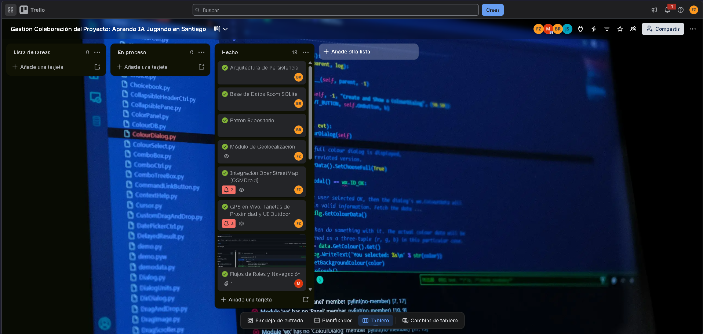

# Aprendo IA Jugando en Santiago 🏙️🤖

Plataforma móvil gamificada, georreferenciada y basada en microservicios para la democratización del aprendizaje de conceptos de Inteligencia Artificial en entornos urbanos cotidianos, desarrollada para **Triskeledu SpA** en el marco del **Examen Final Transversal (EFT)** de la carrera de Informática en Duoc UC.

---

## 1. Nombre del Proyecto
**Aprendo IA Jugando en Santiago** (*Plataforma Móvil Gamificada con Microservicios y Geolocalización*)

---

## 2. Integrantes del Equipo

| Integrante | Rol en el Proyecto | Responsabilidades y Aportes Técnicos Principales |
| :--- | :--- | :--- |
| **Fernando Zapata** | **Líder de Arquitectura y Microservicios** | Diseño e implementación de **Spring Cloud API Gateway** (8080), **Netflix Eureka Server** (8761), módulo de GPS en tiempo real con **Google Play Services Location** (`FusedLocationProviderClient`), validación de proximidad a monumentos y consumo de API meteorológica externa. |
| **Benjamín Gómez** | **Persistencia y Transacciones** | Arquitectura de base de datos relacional MySQL (patrón Database-per-Service), persistencia local con **Room SQLite** en Android, implementación del patrón Repositorio y control transaccional de saldo de puntos. |
| **Magdiel Reynoso** | **Hardware y Seguridad** | Módulo de hardware con **CameraX**, escaneo nativo de códigos QR físicos, captura y validación de selfies turísticas en terreno, y algoritmo de seguridad PBKDF2 con sal individual. |
| **Juan Pablo Taulis** | **Gamificación y Multimedia** | Reproducción de cápsulas educativas audiovisuales sobre IA, sistema de puntuación acumulativa y niveles, canal de notificaciones emergentes del sistema y catálogo de recompensas. |

---

## 3. Funcionalidades Principales

### 📱 Aplicación Móvil (Android / Jetpack Compose)
1. **Mapa Interactivo y Geolocalización en Vivo:** Visualización de marcadores de puntos de interés turístico de Santiago con cálculo de distancia en metros y tarjetas informativas.
2. **Escaneo de Códigos QR Físicos con Cámara:** Detección automática en terreno mediante CameraX, validando que el código pertenezca a un punto turístico (+10 puntos).
3. **Validación de Selfie en Terreno:** Captura fotográfica con almacenamiento en la galería como evidencia de visita a un hito patrimonial (+100 puntos extra).
4. **Reproducción de Cápsulas Multimedia sobre IA:** Visualización de microaprendizajes en video clasificados por categorías (Machine Learning, Redes Neuronales, IA Generativa, Ética, Visión Artificial).
5. **Persistencia Offline-First (Room SQLite):** Base de datos local para almacenar descubrimientos, usuarios, historial de visitas y notificaciones sin requerir conexión constante.
6. **Formularios con Validación Estricta:** Verificación en tiempo real de correos electrónicos (RFC 5322), formato telefónico chileno (+569), nombres y contraseñas seguras.
7. **Notificaciones Nativas del Sistema:** Alertas en barra de estado (`NotificationChannel`) ante desbloqueo de hitos y logros de gamificación.
8. **Condiciones Meteorológicas en Tiempo Real:** Tarjeta informativa con temperatura y estado del clima en Santiago para alertar al usuario antes de salir.

### ⚙️ Ecosistema Distribuido (Spring Boot 3 + Spring Cloud)
1. **Service Discovery (Eureka Server):** Registro y resolución dinámica de microservicios sin direcciones IP cableadas.
2. **API Gateway Centralizado:** Puerta de enlace unificada que gestiona enrutamiento inteligente, CORS y balanceo hacia los microservicios.
3. **Servidor Multimedia Centralizado:** Almacenamiento y streaming de imágenes de puntos turísticos y miniaturas servidas desde el backend, optimizando el tamaño del APK.
4. **Seguridad Criptográfica:** Algoritmo **PBKDF2WithHmacSHA512** para hashing de credenciales con prevención de ataques de temporización (`slowEquals`).
5. **Control de Concurrencia e Idempotencia:** Prevención estricta de fraude que impide sumar puntos repetidos por el mismo código QR o selfie.

---

## 4. Endpoints Utilizados (API Externa y Microservicios)

### 🌐 API Externa (Clima en Santiago)
* **Proveedor:** Open-Meteo Public Weather API
* **Endpoint:** `GET https://api.open-meteo.com/v1/forecast?latitude=-33.4489&longitude=-70.6693&current_weather=true`
* **Propósito:** Provee la temperatura actual, velocidad del viento y código meteorológico de Santiago en tiempo real.

### 🚪 Spring Cloud API Gateway (Puerto `8080`)
Punto de entrada único consumido por la aplicación móvil: `http://10.0.2.2:8080/` (emulador) o `http://127.0.0.1:8080/` (físico).

#### 1. Microservicio de Clientes (`ms-clientes` vía Gateway: `/api/clientes/**`)
* `POST /api/clientes/usuarios/registro` — Registro de nuevo jugador con validaciones estrictas y avatar.
* `POST /api/clientes/usuarios/login` — Autenticación con verificación PBKDF2.
* `GET /api/clientes/usuarios/{id}` — Consulta de perfil, nivel y puntos acumulados.
* `PUT /api/clientes/usuarios/{id}/perfil` — Actualización de datos personales y avatar.
* `PUT /api/clientes/usuarios/{id}/sumar-puntos?puntos={pts}` — Acreditación o descuento atómico de puntos.

#### 2. Microservicio de Localizaciones y Multimedia (`ms-localizaciones` vía Gateway: `/api/localizaciones/**`)
* `GET /api/localizaciones/puntos-interes` — Obtención del catálogo de los 8 puntos turísticos oficiales.
* `GET /api/localizaciones/puntos-interes/{id}` — Detalle, coordenadas y radio de tolerancia de un monumento.
* `POST /api/localizaciones/puntos-interes` — Creación de nuevo punto turístico por el Administrador.
* `PUT /api/localizaciones/puntos-interes/{id}` — Edición de datos geográficos o descripción.
* `DELETE /api/localizaciones/puntos-interes/{id}` — Eliminación protegida (bloquea borrado si tiene cápsulas activas).
* `GET /api/localizaciones/capsulas` — Lista de cápsulas educativas de IA.
* `GET /api/localizaciones/capsulas/validar-qr?codigo={codigo}` — Validación de existencia y estado del código QR.
* `GET /api/localizaciones/multimedia/{nombre}` — Descarga de imágenes turísticas y miniaturas almacenadas en el backend.
* `POST /api/localizaciones/multimedia/imagen` — Carga de nuevas fotografías de monumentos.

#### 3. Microservicio de Premios y Gamificación (`ms-premios` vía Gateway: `/api/premios/**`)
* `POST /api/premios/gamificacion/escanear-qr` — Procesa lectura QR, valida asociación al POI y suma +10 puntos.
* `POST /api/premios/gamificacion/visita-selfie` — Registra fotografía en terreno y acredita bonificación de +100 puntos.
* `POST /api/premios/gamificacion/video-visto` — Marca cápsula como visualizada en el historial.
* `GET /api/premios/gamificacion/descubrimientos/{usuarioId}` — Consulta el historial de hitos descubiertos por jugador.
* `GET /api/premios` — Consulta el catálogo de premios físicos canjeables.
* `POST /api/premios/canjear?usuarioId={id}&premioId={id}` — Canje de recompensas por puntos.
* `GET /api/premios/notificaciones/usuario/{usuarioId}` — Consulta el listado de notificaciones del jugador.
* `PUT /api/premios/notificaciones/{id}/leida` — Marca una notificación como leída.

---

## 5. Pasos para Compilar y Ejecutar

### Requisitos Previos
* **Java:** JDK 21 instalado y configurado en el `PATH`.
* **Motor de Base de Datos:** MySQL Server activo en el puerto `3306` (usuario `root`, contraseña vacía o según variable `MYSQL_PASSWORD`).
* **Entorno Móvil:** Android Studio (Ladybug 2024.2+ o posterior) y emulador con Android 10+ (API 29+) o dispositivo físico con depuración USB.

### Paso 1: Clonar los Repositorios
```bash
# Repositorio Frontend (Android):
git clone https://github.com/BenGomezDUOC/Aprendo-IA-Jugando-en-Santiago-Grupo-Netan-Y-Yahoo.git

# Repositorio Backend (Microservicios):
git clone https://github.com/BenGomezDUOC/backend-jugando-ia-santiago.git
```

### Paso 2: Iniciar el Backend (5 Microservicios)
1. Abre una terminal en la carpeta `backend-jugando-ia-santiago`.
2. Ejecuta con doble clic el script automático:
   ```cmd
   iniciar_servicios.bat
   ```
   *(O en PowerShell: `.\iniciar_servicios.ps1`)*.
3. El script compila y levanta en orden:
   * **Eureka Server:** `http://localhost:8761`
   * **ms-clientes:** `http://localhost:8081`
   * **ms-localizaciones:** `http://localhost:8083`
   * **ms-premios:** `http://localhost:8082`
   * **API Gateway:** `http://localhost:8080`
4. Comprueba en tu navegador que los 3 microservicios aparezcan registrados en [http://localhost:8761](http://localhost:8761).

### Paso 3: Ejecutar la Aplicación Android
1. Abre la carpeta `Aprendo-IA-Jugando-en-Santiago-Grupo-Netan-Y-Yahoo` en Android Studio.
2. Espera la sincronización de Gradle (*Gradle Sync*).
3. Selecciona tu dispositivo físico o emulador.
4. Presiona **Run 'app' (Shift + F10)**.

### Paso 4: Ejecutar Pruebas Unitarias del Frontend
En la terminal del proyecto Android:
```bash
./gradlew testDebugUnitTest
```
*(Se ejecutan las 25 pruebas unitarias con resultado exitoso).*

---

## 6. Captura del APK Firmado y Llave (.jks)

La aplicación ha sido empaquetada y firmada digitalmente para su distribución en producción bajo los esquemas de seguridad **v2 y v3** de Android.

* **Ruta del APK firmado:** `app/build/outputs/apk/release/app-release.apk`
* **Ruta de la llave criptográfica:** `keystore/release.jks`
* **Alias de la llave:** `triskeledu-release`
* **Entidad Emisora del Certificado:** `CN=Triskeledu SpA, OU=Informatica, O=Duoc UC, L=Santiago, ST=Santiago, C=CL`
* **Algoritmo de Clave:** RSA 2048 bits / Validez 10.000 días
* **Huella Digital SHA-256:** `b02e0ddfc6a241ef1eedcc01d07aac3ab3b363143f5e40263ea03c1b576af1f4`
* **Comando de verificación oficial:**
  ```cmd
  apksigner verify --verbose --print-certs app\build\outputs\apk\release\app-release.apk
  ```

### 🖼️ Evidencia del APK Firmado y Llave .jks
<!-- PLACEHOLDER: Guarda tu captura de pantalla de la terminal con apksigner y la carpeta keystore/ con el nombre 'apk_firmado_evidencia.png' dentro de docs/evidencias/ -->


---

## 📌 Evidencia de Trello con Planificación Distribuida

El proyecto se gestionó bajo metodología ágil, dividiendo las épicas, historias de usuario y tareas técnicas entre todos los miembros del equipo:




* **Tablero Oficial:** [Acceso al Tablero Trello](https://trello.com/b/Dp4CqmeK/gestion-colaboracion-del-proyecto-aprendo-ia-jugando-en-santiago)

---

## 🔑 Credenciales Predefinidas para Pruebas

| Rol | Usuario / Alias | Correo Electrónico | Contraseña |
| :--- | :--- | :--- | :--- |
| **Administrador** | Administrador (`Admin`) | `admin@triskeledu.cl` | `123` |
| **Generador de Contenido** | Contenido (`GenCont`) | `contenido@triskeledu.cl` | `123` |
| **Cliente / Jugador** | *(Cualquier jugador registrado)* | *(Correo elegido al registrarse)* | *(Contraseña elegida)* |
